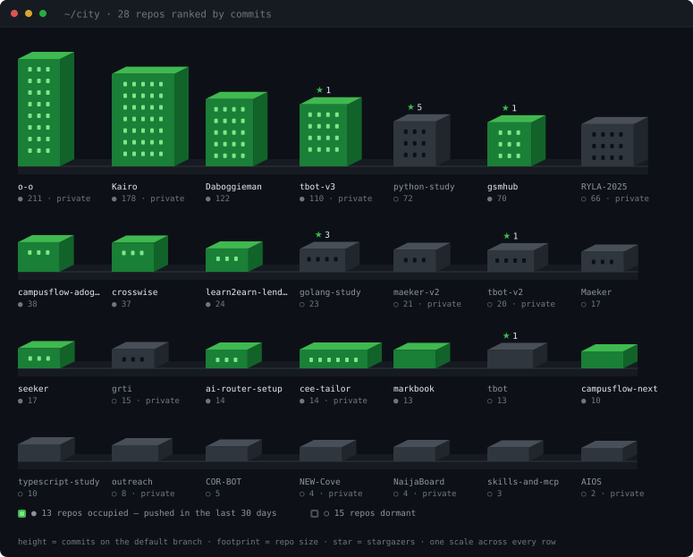
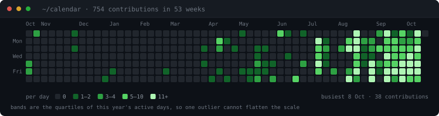
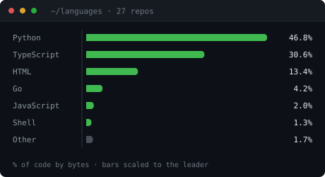
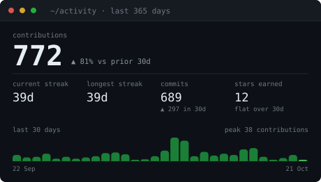
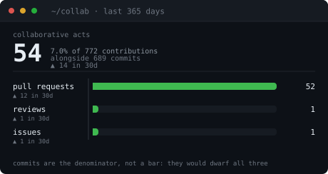
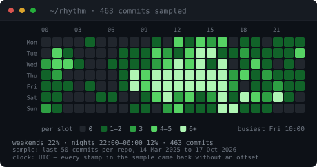
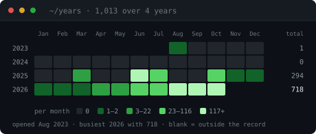
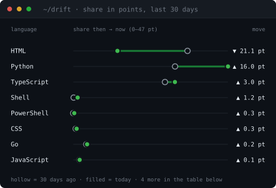

<div align="center">



</div>

## About me

- i think i know more than i did yesterday **(sacrificed some hours of sleep though)**
- Comfortable across the stack — from Go microservices to Python tooling to mobile apps
- Based in Nigeria
- Currently hunting bugs I probably wrote myself

<br/>

## Skyline

Every repository I own is a building: height is commits on the default branch,
footprint is size on disk, a lit facade means I pushed to it in the last 30 days.

<div align="center">



</div>

<br/>

## Contribution Calendar

A year of contributions, one cell per day. The four shades are the quartiles of my
own active days rather than fractions of the busiest one

<div align="center">



</div>

<br/>

## Languages and activity

<div align="center">




</div>

<br/>

## Collaboration and rhythm

<div align="center">




</div>

<br/>

## Years and drift

<div align="center">




</div>

<br/>

## Featured projects

<div align="center">

| Project | What it is |
|---|---|
| **Kairo** | Personal all-in-one fitness app — workouts, progress, GPS tracking, offline-first *(in development, private)* |
| **[python-study](https://github.com/Daboggieman/python-study)** | Python experiments and learning projects (extremely detailed)|
| **[gsmhub](https://github.com/Daboggieman/gsmhub)** | check it out yourself, its kinda cringe tho |
| **[golang-study](https://github.com/Daboggieman/golang-study)** | Go experiments and learning projects |
| **[Maeker](https://github.com/Daboggieman/Maeker)** | Python project |
| **[tbot](https://github.com/Daboggieman/tbot)** | base working version trading algorithm project  |
| **[tbot-v2](https://github.com/Daboggieman/tbot-v2)** | risk aware working version of trading algorithm project |
| **tbot-v3** | editable parameters and implementing a dual-trade system, risk management and reconfigured skills and strategies arsenal *(in development - private)* |
| **tbot-ML** | Machine learning capable version of working tbot-v3 *(in development,private)* |
| **[Agentrouter-setup](https://github.com/Daboggieman/Agentrouter-setup)** | Shell scripts for setting up an agent router |
| **[COR-BOT](https://github.com/Daboggieman/COR-BOT)** | Baby tbot *tbot-v0* (where tbot started) |
| **[typescript-tutorial](https://github.com/Daboggieman/typescript-tutorial)** | Typescript experiments and learning projects *(in development)* |
| **[skills-and-mcp](https://github.com/Daboggieman/skills-and-mcp)** | compilation of agents, skills and MCPs to improve AI assistants in working projects |

</div>

<br/>

## Stack

```console
$ cat stack.txt
languages   Go · Python · TypeScript · JavaScript · Shell
mobile      Expo · React Native · expo-router · expo-sqlite · MapLibre · Zustand
data        PostgreSQL · MongoDB · Redis · SQLite
ops         Docker · Git · GitHub Actions · Vercel · Render · Heroku
testing     Jest · go test
```

<br/>

## Contribution snake

<div align="center">


</div>

<br/>

<details>
<summary>Open the table view</summary>

<!-- cards:table:start -->

| Right now | Reading |
|---|---|
| Focus | gsmhub · TypeScript · pushed in the last hour · 164 contributions this week |
| Last 7 days | 164 contributions |

| Language | Share | Tracked size |
|---|---:|---:|
| Python | 45.9% | 4.2 MB |
| TypeScript | 32.6% | 3.0 MB |
| HTML | 11.9% | 1.1 MB |
| Go | 3.8% | 361.7 kB |
| JavaScript | 1.9% | 177.3 kB |
| Shell | 1.7% | 163.1 kB |
| Other | 2.2% | 203.9 kB |

| Language | Share 30 days ago | Share now | Move |
|---|---:|---:|---:|
| HTML | 33.9% | 11.9% | ▼ 22.0 pt |
| Python | 30.9% | 45.9% | ▲ 15.0 pt |
| TypeScript | 28.2% | 32.6% | ▲ 4.4 pt |
| Shell | 0.1% | 1.7% | ▲ 1.6 pt |
| PowerShell | 0.0% | 0.8% | ▲ 0.8 pt |
| CSS | 0.8% | 1.0% | ▲ 0.2 pt |
| Dockerfile | 0.1% | 0.1% | ▲ 0.1 pt |
| Go | 3.9% | 3.8% | flat |
| SCSS | 0.0% | 0.0% | flat |
| JavaScript | 1.9% | 1.9% | flat |
| Batchfile | 0.2% | 0.2% | flat |
| MQL5 | 0.0% | 0.0% | flat |
| Mako | 0.0% | 0.0% | flat |

| Metric | Last 365 days | Change |
|---|---:|---:|
| Contributions | 983 | ▲ 477 in 30d |
| Commits | 876 | ▲ 435 in 30d |
| Pull requests | 66 | ▲ 26 in 30d |
| Issues | 1 | ▲ 1 in 30d |
| Reviews | 1 | ▲ 1 in 30d |
| Current streak | 48 days | ▲ 31 in 30d |
| Longest streak | 48 days | ▲ 31 in 30d |
| Repositories | 29 | ▲ 6 in 30d |
| Stars earned | 12 | flat over 30d |
| Followers | 13 | ▲ 2 in 30d |
| Collaborative acts | 68 (6.9% of all) | ▲ 28 in 30d |

| Calendar | Value |
|---|---:|
| Busiest day | 24 Oct 2026 (58 contributions) |
| Days with nothing | 251 of 370 days |
| Days with something | 119 |

| Commit rhythm | Value |
|---|---:|
| Busiest slot | Fri 12:00–12:59 (17 commits) |
| Sample | 585 commits, 14 Mar 2025 to 30 Oct 2026 |
| Weekend work | 26% of the sample |
| Nights, 22:00–06:00 | 10% of the sample |
| Clock | UTC — every stamp in the sample came back without an offset |

| Year | Contributions | Active days | Busiest month |
|---|---:|---:|---|
| 2023 | 1 | 1 | Aug (1) |
| 2024 | 0 | 0 | Jan (0) |
| 2025 | 294 | 41 | Jun (147) |
| **2026** | 977 | 116 | Oct (474) |

<sub>The account opened 12 August 2023, so anything before that is absent rather than quiet.</sub>

| Building | Commits | Size | Stars | Last push | State | Access |
|---|---:|---:|---:|---|---|---|
| [projectlearn-project-based-learning](https://github.com/Daboggieman/projectlearn-project-based-learning) | 238 | 14.1 MB | 0 | 30 May 2026 | dormant | public |
| o-o | 215 | 170.0 kB | 0 | 30 Oct 2026 | occupied | private |
| Kairo | 178 | 82.0 MB | 0 | 29 Oct 2026 | occupied | private |
| [Daboggieman](https://github.com/Daboggieman/Daboggieman) | 123 | 7.4 MB | 0 | 30 Oct 2026 | occupied | public |
| tbot-v3 | 110 | 8.3 MB | 1 | 30 Oct 2026 | occupied | private |
| [gsmhub](https://github.com/Daboggieman/gsmhub) | 81 | 1.6 MB | 1 | 30 Oct 2026 | occupied | public |
| [python-study](https://github.com/Daboggieman/python-study) | 72 | 343.0 kB | 5 | 27 Sep 2026 | dormant | public |
| RYLA-2025 | 66 | 23.2 MB | 0 | 12 Jul 2025 | dormant | private |
| [campusflow-adogah](https://github.com/Daboggieman/campusflow-adogah) | 38 | 56.0 kB | 0 | 14 Oct 2026 | occupied | public |
| [crosswise](https://github.com/Daboggieman/crosswise) | 37 | 147.0 kB | 0 | 25 Oct 2026 | occupied | public |
| [seeker](https://github.com/Daboggieman/seeker) | 27 | 1.6 MB | 0 | 30 Oct 2026 | occupied | public |
| cee-tailor | 24 | 228.0 kB | 0 | 30 Oct 2026 | occupied | private |
| [learn2earn-lender](https://github.com/Daboggieman/learn2earn-lender) | 24 | 467.0 kB | 0 | 9 Oct 2026 | occupied | public |
| [golang-study](https://github.com/Daboggieman/golang-study) | 23 | 3.8 MB | 3 | 2 Jul 2026 | dormant | public |
| maeker-v2 | 21 | 375.0 kB | 0 | 18 Aug 2026 | dormant | private |
| tbot-v2 | 20 | 5.3 MB | 1 | 13 Sep 2026 | dormant | private |
| [Maeker](https://github.com/Daboggieman/Maeker) | 17 | 415.0 kB | 0 | 27 Jun 2026 | dormant | public |
| grti | 15 | 418.0 kB | 0 | 5 Apr 2026 | dormant | private |
| [ai-router-setup](https://github.com/Daboggieman/ai-router-setup) | 14 | 96.0 kB | 0 | 26 Oct 2026 | occupied | public |
| [markbook](https://github.com/Daboggieman/markbook) | 13 | 363.0 kB | 0 | 30 Oct 2026 | occupied | public |
| [tbot](https://github.com/Daboggieman/tbot) | 13 | 3.7 MB | 1 | 13 Sep 2026 | dormant | public |
| [campusflow-next](https://github.com/Daboggieman/campusflow-next) | 10 | 154.0 kB | 0 | 20 Oct 2026 | occupied | public |
| [typescript-study](https://github.com/Daboggieman/typescript-study) | 10 | 447.0 kB | 0 | 27 Sep 2026 | dormant | public |
| outreach | 8 | 5.1 MB | 0 | 4 Aug 2026 | dormant | private |
| [COR-BOT](https://github.com/Daboggieman/COR-BOT) | 5 | 107.0 kB | 0 | 14 Jul 2025 | dormant | public |
| NEW-Cove | 4 | 295.0 kB | 0 | 2 Dec 2025 | dormant | private |
| NaijaBoard | 4 | 89.0 kB | 0 | 11 Aug 2026 | dormant | private |
| [skills-and-mcp](https://github.com/Daboggieman/skills-and-mcp) | 3 | 63.0 kB | 0 | 18 Sep 2026 | dormant | public |
| AIOS | 2 | 42.0 kB | 0 | 9 Jan 2026 | dormant | private |

<sub>Building height is commits on the default branch, footprint is repo size, and a lit facade means pushed within 30 days. Private repositories are listed for their activity only — they are not linked, because the link would 404 for everyone but me.</sub>

<sub>Generated by <code>./cmd/cards</code> on 30 October 2026. Includes 12 private repositories, counted for activity but not linked.</sub>

<!-- cards:table:end -->

</details>

<br/>

## Connect

<div align="center">

[](https://github.com/Daboggieman)
[](https://www.linkedin.com/in/adakole-ogah-392a56253/)
[](https://wa.me/2348029462739)
[](YOUR_X_LINK)

</div>
